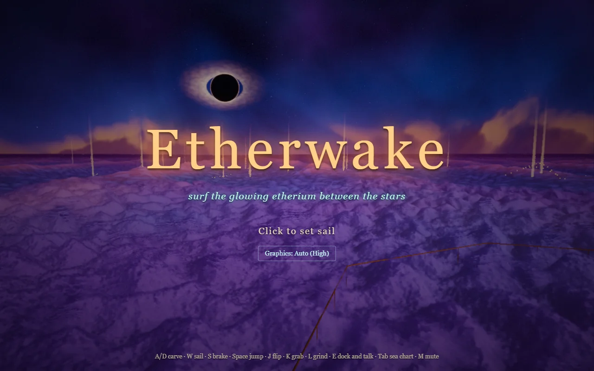

# Etherwake

**Surf the glowing etherium between the stars.** A 3D space-fantasy surfing game that runs in your browser.

**[Play it](https://etherwake.insanealec.workers.dev/)** (best on desktop)



You're a solar surfer working out of a floating port at the edge of a nebula. Ride the etherium's swells on a sail-powered board, land tricks for credits, and spend them on gear that takes you further out. The tone is age-of-sail in space: brass and canvas, lantern light, and a breathable sea of cloud instead of vacuum. Every name, ship and creature is original.

## What's in it

- **Surfing and tricks:** carve, trim the sail, jump, flip, grab and grind. Spins, reverts and big air pay out credits.
- **Jobs and races:** carry parcels between moorings, or race the marshal's gate courses for a best time.
- **Upgrades:** the shipwright sells sail canvas and hull polish to make your board faster.
- **A world to explore:** three regions beyond the harbour (the Flare Reach, the Ring Reach and the Rim), stardust trails to collect, and a sea chart to find your way.
- **A galleon** you can board, walk and steer from the helm, and pods of star-leviathans to surf alongside.
- **On foot:** dock anywhere and walk the port to talk to the people who live there.

Progress saves in your browser. The game is still in development; see [`docs/roadmap.md`](docs/roadmap.md) for what's done and what's next.

## Controls

| Key | Action |
|---|---|
| A / D | Carve |
| W / S | Sail / brake |
| Space | Jump |
| J / K / L | Flip / grab / grind |
| E | Dock and talk |
| Tab | Sea chart |
| M | Mute |

Phones and tablets get on-screen touch controls.

## Requirements

Etherwake runs best in a desktop browser with WebGPU (recent Chrome or Edge) and a dedicated graphics card. It falls back to WebGL 2 where WebGPU isn't available, and the graphics setting on the title screen trades detail for speed.

## How it's built

- **three.js WebGPU:** rendering uses `WebGPURenderer` with node materials written in TSL, three.js's shader language.
- **One source of truth for what you see and what you ride:** systems like the etherium sea are defined once as a parameter table, which produces both a JavaScript function for physics and gameplay (`Etherium.heightAt`) and a TSL function for rendering (`etheriumHeight`). The swell under your board always matches the one on screen.
- **Generated in code:** the sea, sky, port and moonlet are procedural. The few third-party textures and models are CC0, listed in [`CREDITS.md`](CREDITS.md).
- **Data-driven tuning:** gameplay numbers live in data tables (`src/game/Gear.js` and friends) and world positions in `src/world/WorldLayout.js`, so balance changes don't touch game logic.
- **One folder per system:** `core/` (input, cameras, loop), `sky/`, `sea/`, `player/`, `world/`, `game/`, `post/`, `ui/`, `audio/`. `App.js` owns the renderer and frame loop and wires the systems together.

## Running locally

```sh
npm install
npm run dev      # http://127.0.0.1:5190
npm run build    # static build into dist/
npm run deploy   # build and publish to Cloudflare Workers
```

Debug flags go in the URL, for example `?fly` to start in a free camera, `?noAudio`, `?noBloom` or `?stats`. In game, F toggles the free camera and H toggles the tweak panel.

## Docs

- [`docs/concept.md`](docs/concept.md): the design, tone and world
- [`docs/roadmap.md`](docs/roadmap.md): status and what's next
- [`docs/research.md`](docs/research.md): notes on the techniques it builds on
- [`CREDITS.md`](CREDITS.md): third-party assets and licenses
